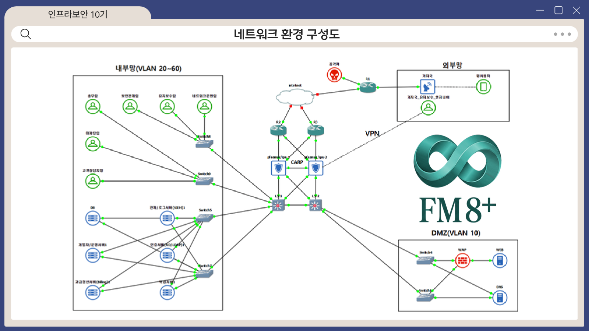
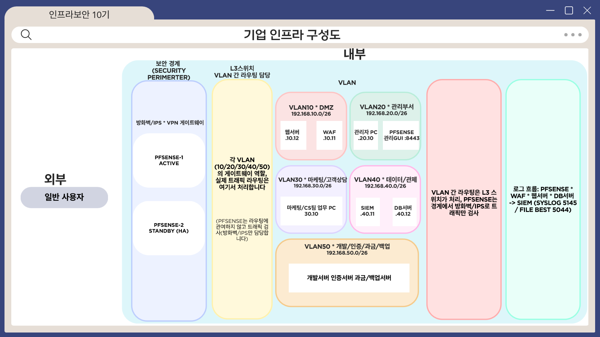
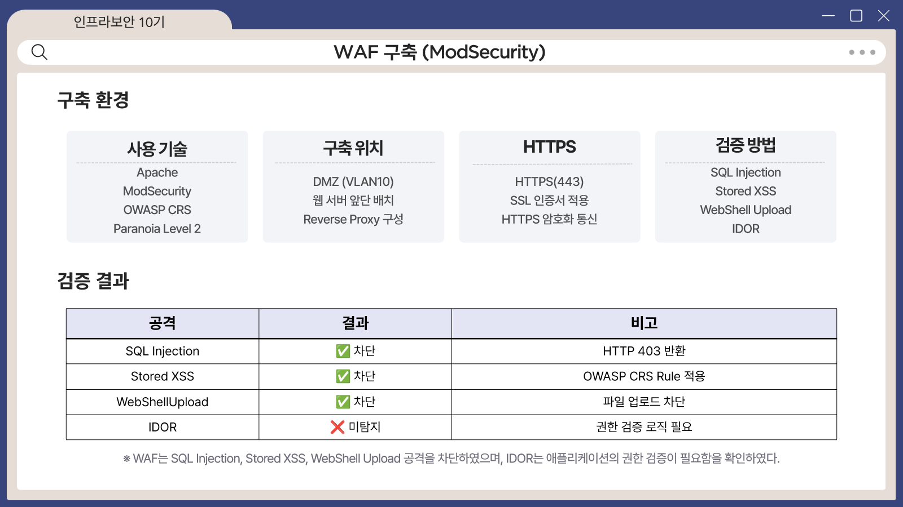
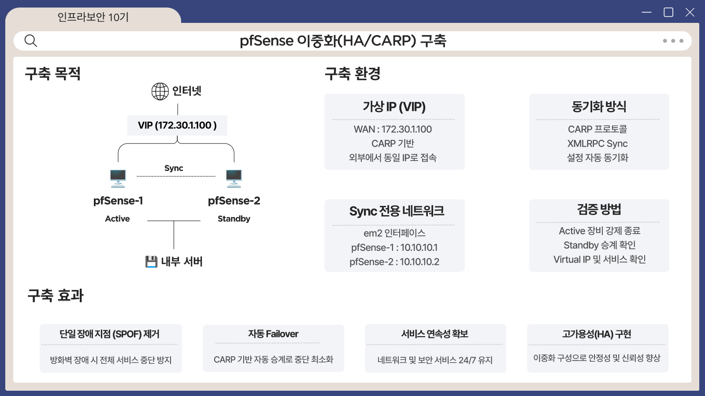
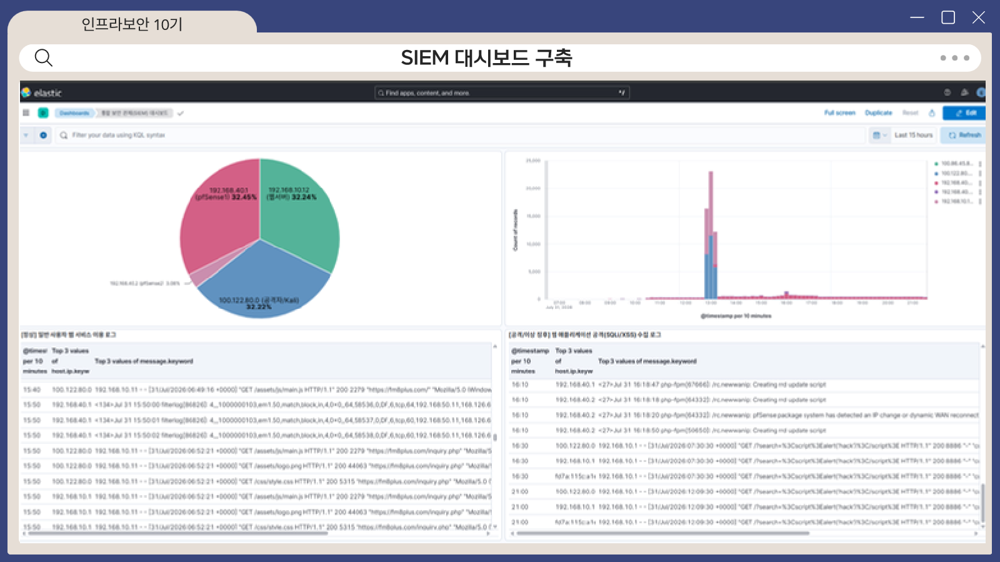

# Operation Follow Me

> 가상 통신사 **FM 8+** 를 대상으로 공격 → 탐지·차단 → 로그 분석 → 복구까지 한 흐름으로 검증한 모의해킹 기반 정보보호 진단 프로젝트

- 기간: 2026.07.23 ~ 2026.08.04 (이스트캠프 가디언즈 인프라보안 10기 최종 프로젝트)
- 팀: 8팀 "팔로팔로미", 5인
- 결과: 최종 프로젝트 1위 · 우수상
- 내 역할: **서비스 인프라** (웹·DB 서버 구축, 취약점 설계, DNS, WAF 룰, DB 백업·복구, 발표)

## 배경

2025년 4월 SKT HSS 해킹 사고(리눅스 커널 백도어 BPFDoor)는 경계 방어 하나만으로는 실제 침해에 대응할 수 없다는 점을 보여줬습니다.
그래서 "공격 → 탐지·차단 → 로그 분석"이 이어지는 다계층 진단 체계를 직접 만들어 검증하기로 했습니다.

## 아키텍처

```
외부 ──> pfSense HA (CARP, Active/Standby) ──> L3 스위치 ──> VLAN 분리
                │ NAT 80/443
                ▼
        VLAN10 DMZ : WAF(ModSecurity) ──> 웹서버(Apache/PHP)
        VLAN20 관리 / VLAN30 직원 PC / VLAN40 SIEM·DB / VLAN50 백업
        모든 장비 로그 ──> ELK(SIEM)
```





| 영역 | 구성 |
|---|---|
| 방화벽 | pfSense 2대 HA(CARP), NAT, VLAN 분리 |
| IDS/IPS | Suricata (WAN 10개 + LAN 5개 커스텀 룰) |
| WAF | ModSecurity + OWASP CRS (Paranoia Level 2) + 커스텀 룰 |
| SIEM | ELK Stack 8.19 (Filebeat/Logstash) |
| 서비스 | Ubuntu 24.04, Apache 2.4, PHP 8.3, MariaDB 10.11, BIND9 |
| 원격 접속 | Tailscale (Split DNS) |

## 내가 한 일

| 영역 | 내용 | 문서 |
|---|---|---|
| 서비스 구축 | 웹서버, DB(13개 테이블, 최소 권한 계정), DNS(BIND9, `fm8plus.com`) | [docs/service.md](docs/service.md) |
| 취약점 설계 | 모의해킹용 취약점 4종을 의도대로 설계 | [docs/vulnerability-design.md](docs/vulnerability-design.md) |
| WAF 룰 | ModSecurity 커스텀 룰 3개 작성·검증 | [docs/waf.md](docs/waf.md) |
| Suricata | WAN 룰 10개 적용·테스트, alert → 선별 drop 전환 | [docs/suricata.md](docs/suricata.md) |
| DB 백업·복구 | 격리 백업 서버, ForceCommand, 풀백업 + binlog(PITR), 복구 시연 | [docs/db-backup-pitr.md](docs/db-backup-pitr.md) |
| 인수인계 문서 | 새 팀원이 이어받을 수 있는 위키 작성 | - |

## 핵심 결과

- 공격 3종(SQLi, Stored XSS, 웹쉘 업로드)을 WAF가 403으로 차단, 룰 ID로 매칭 확인
- IDOR는 요청이 문법적으로 정상이라 WAF로 막을 수 없음을 확인 → 앱 권한 검증으로 보완하는 것이 맞다는 결론
- DB 테이블 삭제 사고를 가정해 SIEM으로 원인 테이블을 특정하고 백업에서 복구
- 백업 SSH 키가 탈취돼도 백업 파일은 지울 수 없도록 설계

| WAF 검증 | pfSense 이중화 | SIEM 대시보드 |
|---|---|---|
|  |  |  |

## 한계와 배운 점

- IDOR 같은 로직 취약점은 WAF·IDS 룰만으로 막을 수 없다. 애플리케이션 단의 권한 검증이 필요하다.
- 구축 중 SIEM 로그 누락 같은 문제를 직접 겪고 해결했다 (예: `host.ip` 미부여 → Filebeat `add_fields`).
- 복구 시연에서는 변경분이 없어 풀백업만 적용했다. binlog 재생 절차는 문서화만 했다.

## 안내

이 프로젝트는 팀이 직접 구축한 **격리된 가상 환경**에서만 수행했습니다.
취약하게 설계한 애플리케이션 코드와 실행 가능한 공격 코드는 이 저장소에 포함하지 않습니다.
