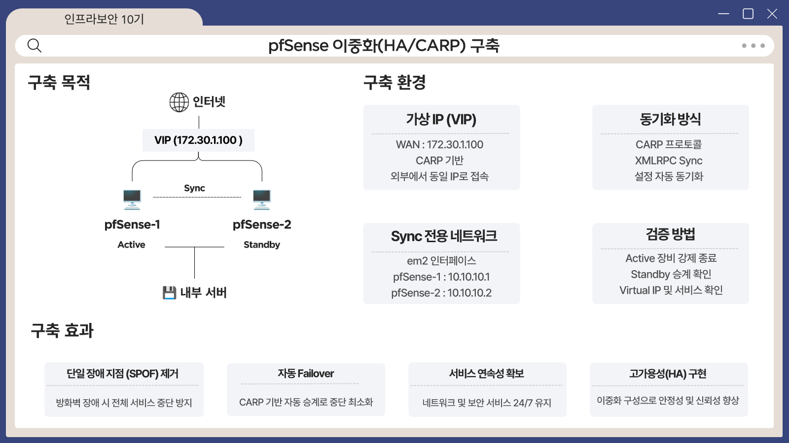

# pfSense 이중화 (HA / CARP)

## 왜 필요했나

방화벽이 한 대뿐이면 그 장비가 멈출 때 전체 서비스가 끊깁니다(단일 장애점, SPOF).
통신사 서비스를 가정한 프로젝트라 방화벽도 이중화해, 한 대가 장애가 나도 서비스가 이어지도록 구성했습니다.

## 구성

| 항목 | 내용 |
|---|---|
| 장비 | pfSense 2대 (Active / Standby) |
| 이중화 방식 | CARP 프로토콜, 가상 IP(VIP) 공유 |
| 외부 접속 | 두 장비가 하나의 WAN VIP를 공유 → 외부에서는 항상 같은 주소로 접속 |
| 설정 동기화 | XMLRPC Sync로 Active의 설정을 Standby에 자동 반영 |
| 동기화 전용 네트워크 | 별도 인터페이스(em2)로 두 장비 연결 |

## 검증

| 시험 | 기대 | 결과 |
|---|---|---|
| Active 장비를 강제 종료 | Standby가 Active로 승계 | 승계 확인 |
| 승계 후 VIP와 서비스 | 같은 주소로 계속 접속 | VIP와 서비스 정상 확인 |

## 효과

- 방화벽 장애가 전체 서비스 중단으로 번지지 않음 (SPOF 제거)
- CARP 기반 자동 승계로 중단 시간 최소화
- 설정이 자동 동기화되어, 장애 대비 설정이 어긋날 위험이 줄어듦

## 연결되는 구성

외부 요청은 WAN VIP로 들어와 pfSense의 NAT(80/443)를 거쳐 WAF → 웹서버로 전달됩니다.
이 경로가 모두 이중화된 방화벽 위에서 동작합니다. 자세한 흐름은 [service.md](service.md)를 참고하세요.
