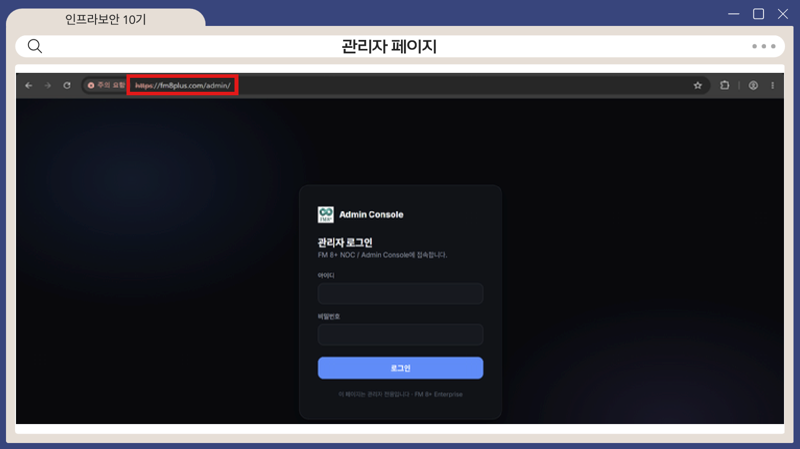

# 서비스 구축 (웹 · DB · DNS)

## 웹서버

| 항목 | 내용 |
|---|---|
| OS | Ubuntu 24.04 |
| 웹서버 | Apache 2.4.58 |
| 언어 | PHP 8.3.6 |
| 위치 | DMZ (VLAN10), WAF 뒤에 배치 |

## DB 서버

- MariaDB 10.11, `fm8plus` DB, 4개 업무 영역을 **13개 테이블**로 분리 설계
- 접근 제어: 전용 계정 사용, 접속 IP 제한, 최소 권한 원칙
- 웹서버만 접근 허용

## DNS

| 항목 | 내용 |
|---|---|
| 프로그램 | BIND9 |
| 도메인 | `fm8plus.com` |
| 레코드 | A(`fm8plus.com`, `www`) → WAN VIP, NS(`ns1`) |
| 팀원 접속 | Tailscale Split DNS |

실제 접속 주소를 서버 IP가 아닌 WAN VIP로 두어, 모든 요청이 **pfSense NAT → WAF → 웹서버** 경로를 거치도록 설계했습니다. 내부 웹서버 주소는 외부에 노출되지 않습니다.

관리자 페이지는 일반 사용자 페이지와 연동하지 않고 `/admin` 으로 따로 분리했습니다.

