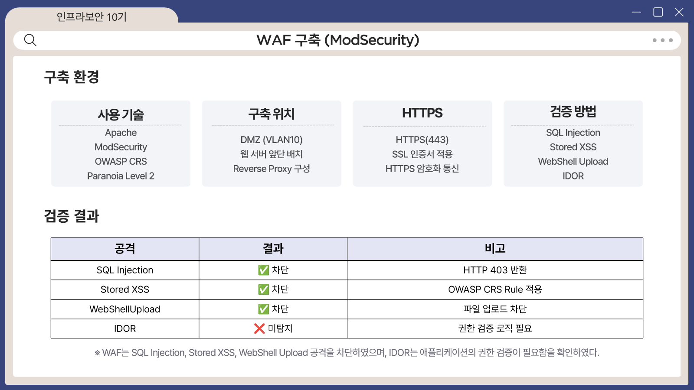

# WAF (ModSecurity)

Apache + ModSecurity 2.9.7 + OWASP CRS (Paranoia Level 2)를 웹서버 앞단 Reverse Proxy로 배치했습니다.

## 커스텀 룰

```apache
SecRule ARGS "@rx (?i:('\s*(--|#))|(\bunion\s+select\b)|(\bor\s+1\s*=\s*1\b))" \
  "id:2000001,phase:2,deny,status:403,msg:'FM8+ Custom SQL Injection Detected',log"

SecRule ARGS "@rx <script" \
  "id:2000002,phase:2,deny,status:403,msg:'FM8+ Custom XSS Detected',log"

SecRule FILES_TMP_CONTENT "@rx <\?php" \
  "id:2000003,phase:2,deny,status:403,msg:'FM8+ Custom Webshell Upload Detected (content-based)',log"
```

| ID | 탐지 대상 | 설계 포인트 |
|---|---|---|
| 2000001 | SQLi (`'--`, `'#`, `union select`, `or 1=1`) | `union select`만 잡던 것을 로그인 우회 패턴까지 확장 |
| 2000002 | XSS (`<script`) | - |
| 2000003 | 웹쉘 업로드 | 확장자가 아니라 **파일 내용의 `<?php`** 검사, `.jpg`로 위장해도 탐지 |

## 검증

감사 로그를 실시간 필터링하여 확인했습니다.

| 공격 | 결과 | 매칭 룰 |
|---|---|---|
| SQL Injection | 403 차단 | 2000001 |
| Stored XSS | 403 차단 | 2000002 |
| 웹쉘 업로드 | 403 차단 | 2000003 |
| IDOR | **차단 못 함** | - |



## 한계

IDOR(`member_id` 값만 바꾸는 요청)는 문법적으로 정상 요청이라 패턴 기반 WAF로 구분할 수 없습니다.
이런 로직 취약점은 애플리케이션의 권한 검증으로 막아야 합니다.
